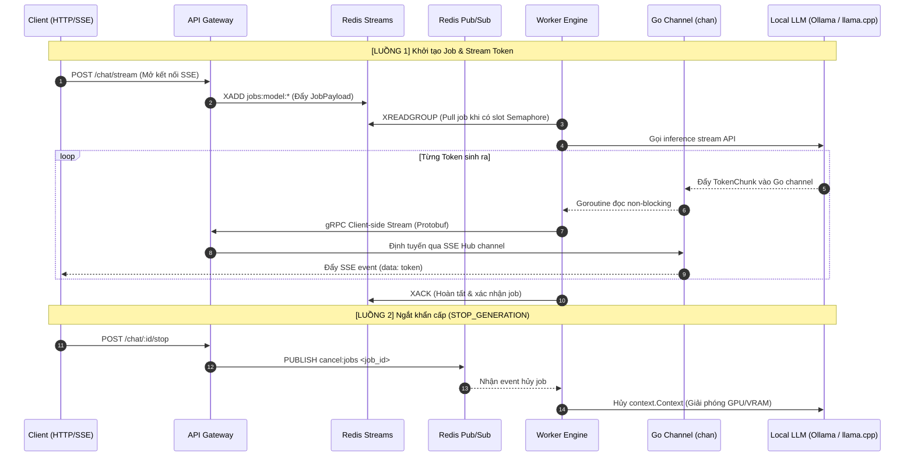

# Phân Vai Bộ Tứ Công Nghệ Cốt Lõi

Tài liệu phân định rõ vai trò, phạm vi truyền dữ liệu và ranh giới phối hợp giữa 4 thành phần truyền thông cốt lõi trong hệ thống **Go Distributed LLM**.

Tham chiếu kiến trúc tổng thể: [docs/tech-stack.md](file:///d:/A_Self_Proj/learn_mlflow/proj8_godistributed_llm/docs/tech-stack.md)  
Tham chiếu cấu trúc mã nguồn: [docs/structure.md](file:///d:/A_Self_Proj/learn_mlflow/proj8_godistributed_llm/docs/structure.md)

---

## 1. Bảng Phân Vai Chuẩn

| Công nghệ | Vai trò trong hệ thống | Phạm vi giao tiếp | Cơ chế hoạt động & Giá trị cốt lõi |
| :--- | :--- | :--- | :--- |
| **Redis Streams** | **Hàng đợi phân tán (Job Queue)** | `Gateway -> Worker` | Lưu trữ bền vững request ban đầu theo từng model. Dùng `XREADGROUP` để Worker nào rảnh mới kéo (pull) job về, bảo vệ GPU/CPU không bị ngập request. |
| **Go Channel (`chan`)** | **Đường ống nội bộ (In-memory Pipe)** | `Bên trong Worker & Gateway` | Nhận luồng byte từ Local LLM (Ollama / llama.cpp) đẩy qua goroutine gửi gRPC (hoặc từ gRPC server sang SSE Hub) mà không làm nghẽn (block) tiến trình đọc I/O. |
| **gRPC (Client Stream)** | **Đường truyền Token tốc độ cao** | `Worker -> Gateway` | Khi Worker nhặt được job từ Redis Stream, nó mở kết nối gRPC bắn thẳng các chunk nhị phân (Protobuf) về Gateway với độ trễ cực thấp và kiểm soát trạng thái đứt kết nối (`Context Cancel`) tức thì. |
| **Redis Pub/Sub** | **Điều khiển thời gian thực & Broadcast** | `Gateway <-> All Workers` | Bắn tín hiệu dừng khẩn cấp (`STOP_GENERATION`), đồng bộ trạng thái Node cho Admin Dashboard, hoặc chuyển tiếp token nếu User đang kết nối ở một instance Gateway khác. |

---

## 2. Sơ Đồ Phối Hợp Theo Vòng Đời Request



---

## 3. Nguyên Tắc Không Chồng Chéo Trách Nhiệm

- **Không dùng Redis Pub/Sub để xếp hàng job**: Pub/Sub không lưu trữ (fire-and-forget), nếu Worker tạm mất kết nối sẽ mất request; việc nhận job bắt buộc đi qua **Redis Streams**.
- **Không dùng Redis Streams để đẩy từng token**: Tránh ghi hàng nghìn message nhỏ vào disk/memory của Redis; token đi thẳng qua **gRPC Client Stream** về đúng IP Gateway đang giữ socket của User.
- **Tách biệt I/O mạng và I/O suy luận**: **Go Channel** làm bộ đệm trung gian (pipeline) giúp tốc độ đọc HTTP stream từ LLM Engine và tốc độ gửi gRPC/SSE không khóa lẫn nhau.

---

## 4. Ghi Chú Chạy Nhanh

```powershell
# 1. Hạ tầng (Redis + PostgreSQL)
cd backend/deployments
docker compose up -d

# 2. Sinh Protobuf (chạy 1 lần)
cd backend
protoc --go_out=. --go_opt=paths=source_relative --go-grpc_out=. --go-grpc_opt=paths=source_relative api/proto/llm_stream.proto

# 3. Kiểm tra model Ollama local
ollama list

# 4. Terminal 1 (Gateway) & Terminal 2 (Worker)
cd backend
go run cmd/gateway/main.go -config configs/gateway.yaml
go run cmd/worker/main.go -config configs/worker.yaml

# 5. Terminal 3 (Frontend)
cd frontend
pnpm dev

# 6. Test API (port 8088)
cd backend
.\scripts\test_api.ps1 -Model "qwen2.5:1.5b"
```

