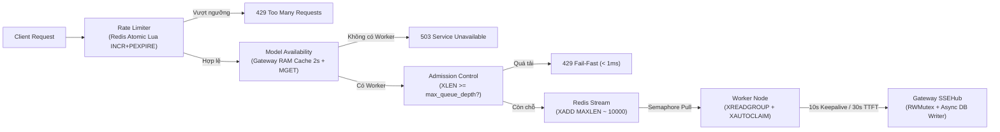

# Độ Ổn Định, Sức Chịu Tải & Kiến Trúc Scale Hệ Thống

Tài liệu phân tích năng lực chịu tải, các cơ chế bảo vệ độ ổn định (Fault Tolerance), tối ưu thông lượng và chỉ số giám sát vận hành của hệ thống **Go Distributed LLM**.

Tham chiếu liên quan:
- Tổng quan công nghệ: [docs/overview.md](file:///d:/A_Self_Proj/learn_mlflow/proj8_godistributed_llm/docs/overview.md)
- Tech Stack & Swap: [docs/tech-stack.md](file:///d:/A_Self_Proj/learn_mlflow/proj8_godistributed_llm/docs/tech-stack.md)
- Luồng hoạt động: [docs/workflow.md](file:///d:/A_Self_Proj/learn_mlflow/proj8_godistributed_llm/docs/workflow.md)

---

## 1. Sơ Đồ Các Lớp Bảo Vệ & Chịu Tải (Resilience Pipeline)

---

## 2. Ước Lượng Sức Chịu Tải Theo Quy Mô

Hệ thống tách biệt **Tầng Điều Phối (Go + Redis)** và **Tầng Suy Luận (GPU/CPU Local LLM)**, nhờ đó có thể scale ngang độc lập hai phía:

| Quy mô triển khai | Cấu hình cụm | Worker Nodes tối đa | Kết nối SSE mở đồng thời | User sinh chữ song song | Active Users ước tính |
| :--- | :--- | :--- | :--- | :--- | :--- |
| **Local / Dev** | 1 Gateway + 1 Redis + 1 Ollama (`max_parallel_jobs: 2`) | 1 – 5 | ~1.000 | 2 | 10 – 30 |
| **Team / LAN nhỏ** | 1 Gateway + 1 Redis + 10 Ollama (`max_parallel_jobs: 2`) | 10 – 50 | 5.000 – 15.000 | 20 | 150 – 400 |
| **Production GPU Cluster** | 3–5 Gateway (sau LB) + Redis + 20 vLLM (`max_parallel_jobs: 16–32`) | 100 – 1.000+ | 20.000 – 60.000+ | 320 – 640 | 3.000 – 10.000+ |

> **Lưu ý về nút thắt hiệu năng**: Tốc độ nhảy token mà User nhìn thấy phụ thuộc chủ yếu vào phần cứng GPU và Inference Engine (`Ollama` vs `vLLM`/`SGLang` continuous batching). Độ trễ truyền qua mạng LAN giữa Worker và Gateway chỉ khoảng **0.2 – 1.5 ms/token** (so với **12 – 65 ms/token** thời gian suy luận của mô hình).

---

## 3. Các Cơ Chế Đảm Bảo Độ Ổn Định (Fault Tolerance)

### 3.1. Chống sập GPU & Bảo vệ Worker
- **Semaphore trước khi kéo job** ([engine.go](file:///d:/A_Self_Proj/learn_mlflow/proj8_godistributed_llm/worker/internal/worker/engine.go)): Worker chỉ gọi `PullJobFromModels` (`XREADGROUP`) khi lấy được slot Semaphore (`max_parallel_jobs`). Máy bận sẽ không kéo job mới về giữ trong RAM, nhường cơ hội cho máy khác đang rảnh.
- **Hard Job Timeout** (`max_job_duration_sec`, mặc định `300s` trong [worker.yaml](file:///d:/A_Self_Proj/learn_mlflow/proj8_godistributed_llm/worker/configs/worker.yaml) và [processor.go](file:///d:/A_Self_Proj/learn_mlflow/proj8_godistributed_llm/worker/internal/worker/processor.go)): Bảo vệ slot Semaphore không bị kẹt vĩnh viễn nếu LLM Engine bị treo giữa chừng sau khi đã nhả token đầu.
- **Circuit Breaker + Health Probe** ([circuit_breaker.go](file:///d:/A_Self_Proj/learn_mlflow/proj8_godistributed_llm/worker/internal/worker/circuit_breaker.go), [engine.go](file:///d:/A_Self_Proj/learn_mlflow/proj8_godistributed_llm/worker/internal/worker/engine.go)): Sau `3` lỗi liên tiếp từ engine cục bộ, breaker chuyển `OPEN` (`UNHEALTHY` trên heartbeat), tạm ngừng kéo job và chạy probe mỗi `10s` (`HALF_OPEN`) để tự hồi phục khi Ollama/vLLM sống lại.
- **Tự cứu job (`XAUTOCLAIM`) + Dead-Letter Queue (`jobs:dlq`)** ([stream_queue.go](file:///d:/A_Self_Proj/learn_mlflow/proj8_godistributed_llm/shared/repositories/redis/stream_queue.go)): Vòng lặp nền mỗi `15s` kiểm tra message nằm quá `45s` trong `PEL`. Nếu vượt quá `3` lần thử (`XPENDING`), job lỗi được đẩy sang `jobs:dlq` và `XACK` khỏi stream chính để chống crash loop; đồng thời `ReclaimStaleAffinityJobs` cứu các job nằm trên stream riêng `jobs:worker:<id>` của node vừa offline.
- **Bảo trì không rớt request (`Drain / Resume`)** ([admin_handler.go](file:///d:/A_Self_Proj/learn_mlflow/proj8_godistributed_llm/backend/internal/handlers/admin_handler.go), [engine.go](file:///d:/A_Self_Proj/learn_mlflow/proj8_godistributed_llm/worker/internal/worker/engine.go), [webui/server.go](file:///d:/A_Self_Proj/learn_mlflow/proj8_godistributed_llm/worker/internal/webui/server.go)): Admin hoặc chủ máy Worker có thể bấm Drain trên Console (`:9091`), Worker chuyển trạng thái `DRAINING` và hoàn thành nốt các job đang sinh token trước khi tắt máy.
- **Heartbeat tự hết hạn (TTL 12s)** ([heartbeat.go](file:///d:/A_Self_Proj/learn_mlflow/proj8_godistributed_llm/worker/internal/worker/heartbeat.go)): Worker gửi CPU, RAM, GPU VRAM, trạng thái (`ONLINE` / `DRAINING` / `UNHEALTHY`) và danh sách model (hỗ trợ `dynamic_model_sync`) mỗi `5s`. Nếu Worker rớt mạng hoặc mất điện, record tự biến mất sau `12s`.

### 3.2. Chống treo kết nối & Ngắt khẩn cấp
- **Kiểm tra model khả dụng (`503`)**: Gateway từ chối ngay nếu không có Worker active nào phục vụ model được yêu cầu.
- **Admission Control (`429 Fail-Fast`)**: Khi hàng đợi Redis Stream của model chạm ngưỡng `max_queue_depth` (mặc định `500` trong [gateway.yaml](file:///d:/A_Self_Proj/learn_mlflow/proj8_godistributed_llm/backend/configs/gateway.yaml)), Gateway trả ngay `429 Too Many Requests` kèm `Retry-After: 5` để tránh sập dây chuyền.
- **First-Token Timeout (`30s`) & SSE Keepalive (`10s`)** ([chat_handler.go](file:///d:/A_Self_Proj/learn_mlflow/proj8_godistributed_llm/backend/internal/handlers/chat_handler.go), [openai_handler.go](file:///d:/A_Self_Proj/learn_mlflow/proj8_godistributed_llm/backend/internal/handlers/openai_handler.go)):
  - Nếu sau `30s` chưa nhận được token đầu tiên, Gateway tự hủy job và trả `504 Gateway Timeout` (hoặc SSE `error` event).
  - Cứ mỗi `10s` chờ, Gateway gửi `: keepalive\n\n` để Nginx/Cloudflare/ALB không cắt socket SSE idle.
- **Ngắt GPU tức thì khi User đóng tab / bấm Stop**: `SSEHub` phát hiện `clientGone`, gọi `PublishCancel` qua Redis Pub/Sub -> Worker kích hoạt `context.WithCancel` đóng HTTP connection tới Ollama/vLLM ngay lập tức, giải phóng VRAM cho người kế tiếp.

### 3.3. An toàn đồng thời, Backpressure & Graceful Shutdown
- **`SSEHub` chống panic & Backpressure thật qua Go Channel** ([sse_hub.go](file:///d:/A_Self_Proj/learn_mlflow/proj8_godistributed_llm/backend/internal/services/sse_hub.go)): Mọi channel buffer `256` được bọc `sync.RWMutex`, chờ backpressure ngắn (`50ms` cho token thường, `500ms` cho chunk `Done`/`Error`) trước khi ghi nhận metric `llm_gateway_dropped_tokens_total` thay vì drop âm thầm.
- **Micro-Batching Token trên Go Channel Pipeline** ([processor.go](file:///d:/A_Self_Proj/learn_mlflow/proj8_godistributed_llm/worker/internal/worker/processor.go)): Token đầu tiên luôn flush ngay (`0ms` thêm vào TTFT); các token sau được gộp theo cửa sổ `batch_flush_ms` (`20ms` hoặc tối đa `8` tokens) kèm `TokenUnits` để giảm số gRPC frames ở tải cao.
- **Graceful Shutdown** ([cmd/gateway/main.go](file:///d:/A_Self_Proj/learn_mlflow/proj8_godistributed_llm/backend/cmd/gateway/main.go), [cmd/worker/main.go](file:///d:/A_Self_Proj/learn_mlflow/proj8_godistributed_llm/worker/cmd/worker/main.go)): Bắt `SIGINT`/`SIGTERM`, chờ `httpServer.Shutdown`, `grpcServer.GracefulStop()`, `asyncRepo.Close()` (flush hết dữ liệu DB đang chờ), và `wg.Wait()` các job đang chạy trên Worker.

---

## 4. Các Tối Ưu Cho Scale Lớn & Định Tuyến Thông Minh

| Thành phần | Vấn đề trước khi tối ưu | Giải pháp đã áp dụng | File phụ trách |
| :--- | :--- | :--- | :--- |
| **Node Discovery** | `SCAN` + `N` lệnh `GET` lặp lại ở mỗi request | Cache danh sách node trong RAM Gateway (`TTL 2s`) + `SCAN` kèm `MGET` + lọc bỏ `UNHEALTHY`/`DRAINING` | [chat_service.go](file:///d:/A_Self_Proj/learn_mlflow/proj8_godistributed_llm/backend/internal/services/chat_service.go), [node_registry.go](file:///d:/A_Self_Proj/learn_mlflow/proj8_godistributed_llm/shared/repositories/redis/node_registry.go) |
| **Priority & KV Affinity** | Mọi job kéo chung 1 FIFO stream | Hỗ trợ 3 mức priority (`high`/`normal`/`low`) + Consistent Hash `conversation_id` vào `jobs:worker:<id>` giữ KV-Cache GPU | [chat_service.go](file:///d:/A_Self_Proj/learn_mlflow/proj8_godistributed_llm/backend/internal/services/chat_service.go), [stream_queue.go](file:///d:/A_Self_Proj/learn_mlflow/proj8_godistributed_llm/shared/repositories/redis/stream_queue.go) |
| **Cancel Pub/Sub** | Mỗi job mở 1 Redis `SUBSCRIBE` riêng | Gộp về **1 kênh duy nhất** `ctrl:cancel:all` cho mỗi Worker + tra cứu `activeCancels sync.Map` O(1) | [pubsub_bus.go](file:///d:/A_Self_Proj/learn_mlflow/proj8_godistributed_llm/shared/repositories/redis/pubsub_bus.go), [engine.go](file:///d:/A_Self_Proj/learn_mlflow/proj8_godistributed_llm/worker/internal/worker/engine.go) |
| **True Backlog & DLQ** | `XLEN` đếm cả job đã xong, `XAUTOCLAIM` lặp vô tận | Đo backlog thật bằng `XINFO GROUPS` (`Pending + Lag`) + đẩy poison job > `3` lần sang `jobs:dlq` | [stream_queue.go](file:///d:/A_Self_Proj/learn_mlflow/proj8_godistributed_llm/shared/repositories/redis/stream_queue.go) |
| **Redis High Availability** | Chỉ nối được 1 node Redis đơn lẻ | Dùng `redis.UniversalClient` hỗ trợ Standalone, Sentinel (`master_name`) & Cluster (nhiều `addr`) | [client.go](file:///d:/A_Self_Proj/learn_mlflow/proj8_godistributed_llm/shared/repositories/redis/client.go) |
| **Rate Limiter** | Đếm cục bộ trong RAM từng Gateway | Lua script nguyên tử (`INCR + PEXPIRE`) trên Redis dùng chung cho toàn cụm Gateway | [rate_limiter.go](file:///d:/A_Self_Proj/learn_mlflow/proj8_godistributed_llm/shared/repositories/redis/rate_limiter.go), [middleware.go](file:///d:/A_Self_Proj/learn_mlflow/proj8_godistributed_llm/backend/internal/handlers/middleware.go) |
| **PostgreSQL & Usage** | Ghi đồng bộ & đếm chunk thô | Bọc qua `AsyncRepository` (`2048` buffer) + lưu `prompt_tokens`, `completion_tokens`, `trace_id` thật từ engine | [async_repo.go](file:///d:/A_Self_Proj/learn_mlflow/proj8_godistributed_llm/backend/internal/repositories/async_repo.go), [chat_repo.go](file:///d:/A_Self_Proj/learn_mlflow/proj8_godistributed_llm/backend/internal/repositories/postgres/chat_repo.go) |

---

## 5. Giám Sát & Chỉ Số Vận Hành (`/metrics` & Admin API)

### 5.1. Prometheus Metrics (`GET /metrics`)
Được xuất chuẩn `text/plain; version=0.0.4` tại [metrics.go](file:///d:/A_Self_Proj/learn_mlflow/proj8_godistributed_llm/backend/internal/metrics/metrics.go):

| Metric | Loại | Ý nghĩa |
| :--- | :--- | :--- |
| `llm_gateway_active_streams` | Gauge | Số kết nối SSE streaming đang mở tại thời điểm hiện tại |
| `llm_gateway_requests_total{endpoint,status}` | Counter | Tổng số request theo endpoint và HTTP status (`200`, `429`, `503`, `504`...) |
| `llm_gateway_tokens_total{model,worker_id}` | Counter | Tổng số token đã stream theo từng model và Worker Node |
| `llm_gateway_ttft_ms_sum` / `_count` | Counter | Tổng và số lần đo Time-To-First-Token (tính TTFT trung bình) |
| `llm_gateway_generation_duration_ms_sum` / `_count` | Counter | Tổng thời gian hoàn tất sinh câu trả lời theo model |

### 5.2. Ngưỡng cảnh báo khuyến nghị khi vận hành Production
- **Queue Backlog (`GET /api/v1/admin/queues`)**: Tăng liên tục > `50%` `max_queue_depth` -> Cần bật thêm Worker Node hoặc tăng `max_parallel_jobs` trên vLLM.
- **TTFT trung bình**: > `5.000 ms` -> Worker đang thiếu VRAM/GPU hoặc đang bị swap model liên tục.
- **GPU VRAM (`gpu_vram_percent`)**: > `92%` -> Nguy cơ OOM; giảm `max_parallel_jobs` trong [worker.yaml](file:///d:/A_Self_Proj/learn_mlflow/proj8_godistributed_llm/worker/configs/worker.yaml) hoặc chuyển sang model lượng tử nhẹ hơn (`Q4_K_M`).
- **Tỷ lệ `429` / `504`**: > `2%` tổng request -> Kích hoạt cảnh báo quá tải cụm.

---

## 6. Checklist Tinh Chỉnh Khi Lên Production

1. **Bật bảo mật**:
   - Đặt `auth.api_key` và `auth.rate_limit_rpm` (VD: `60`) trong [gateway.yaml](file:///d:/A_Self_Proj/learn_mlflow/proj8_godistributed_llm/backend/configs/gateway.yaml).
   - Đặt mật khẩu cho Redis (`--requirepass`) và bỏ `--protected-mode no` trong [docker-compose.yml](file:///d:/A_Self_Proj/learn_mlflow/proj8_godistributed_llm/backend/deployments/docker-compose.yml).
   - Cấu hình `grpc_tls_cert` / `grpc_tls_key` và `grpc_tls_ca` nếu Worker chạy qua WAN/Internet.
2. **Tối ưu Engine**:
   - Dùng `provider: "vllm"` (OpenAI-compatible) cho các máy GPU nhiều người dùng đồng thời.
   - Đặt `advertise_grpc_addr` / `advertise_http_addr` thành IP nội bộ/VPC riêng của từng Gateway instance khi chạy nhiều Gateway sau Load Balancer.

