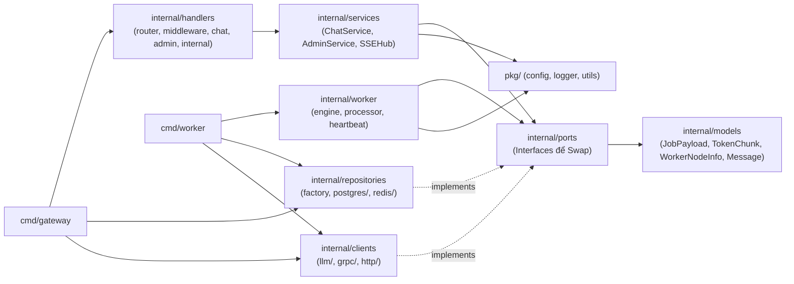

# Cấu Trúc Mã Nguồn Dự Án (`proj8_godistributed_llm`)

Cấu trúc thư mục kết hợp **Layered Architecture (`handlers / services / models / repositories / clients / utils`)** và **Ports (Interfaces)** giúp code dễ đọc, dễ scale ngang và swap tự do từng thành phần hạ tầng (Database, Message Queue, LLM Engine, Token Transport).

Tham chiếu: [docs/overview.md](file:///d:/A_Self_Proj/learn_mlflow/proj8_godistributed_llm/docs/overview.md) | [docs/tech-stack.md](file:///d:/A_Self_Proj/learn_mlflow/proj8_godistributed_llm/docs/tech-stack.md) | [docs/workflow.md](file:///d:/A_Self_Proj/learn_mlflow/proj8_godistributed_llm/docs/workflow.md)

---

## 1. Sơ Đồ Phụ Thuộc Giữa Các Tầng



---

## 2. Cây Thư Mục Chi Tiết

```text
proj8_godistributed_llm/
├── README.md                            # Tài liệu hướng dẫn chính & Quick Start
├── Makefile                             # Lệnh tắt ở root (make proto, make run-gateway, make run-worker, make run-worker-desktop, make run-frontend)
├── .gitignore                           # Ignore bin/, *.exe, .next/, node_modules/, .env
├── go.work                              # Go Workspace trỏ tới ./shared, ./backend, ./worker, ./frontend-worker
│
├── docs/                                # Toàn bộ tài liệu kiến trúc & luồng vận hành
│   ├── overview.md
│   ├── tech-stack.md
│   ├── structure.md
│   ├── workflow.md
│   └── scalability-and-reliability.md   # Phân tích độ ổn định, sức chịu tải & tối ưu scale
│
├── shared/                              # [SHARED MODULE: go-distributed-llm/shared]
│   ├── api/proto/                       # Hợp đồng gRPC Protobuf (llm_stream.proto + generated Go files)
│   ├── models/                          # JobPayload, TokenChunk, WorkerNodeInfo, Message, UsageLog
│   ├── ports/                           # Interfaces Swap hạ tầng (LLMProvider, JobQueue, EventBus, NodeRegistry, TokenStreamer, Repository)
│   ├── repositories/redis/              # Redis UniversalClient, StreamQueue (Priority/DLQ/Affinity), PubSub, NodeRegistry, RateLimiter
│   ├── pkg/
│   │   ├── config/loader.go             # Đọc YAML + ENV overrides cho Gateway & Worker
│   │   ├── logger/logger.go             # Structured Logging (log/slog)
│   │   └── utils/sysinfo.go             # Đo % CPU, % RAM & % GPU VRAM (nvidia-smi)
│   └── go.mod
│
├── backend/                             # [GATEWAY MODULE: go-distributed-llm]
│   ├── cmd/gateway/main.go              # Entrypoint API Gateway (Wire repos -> services -> handlers + gRPC)
│   ├── configs/gateway.yaml             # Cấu hình HTTP (:8088), gRPC (:50051), Redis, Postgres driver, Auth API key
│   ├── internal/
│   │   ├── services/                    # ChatService, AdminService, SSEHub (+ tests)
│   │   ├── handlers/                    # router, middleware, chat, openai (/v1/*), admin, internal, /metrics
│   │   ├── metrics/metrics.go           # Prometheus /metrics exposition
│   │   ├── repositories/                # factory, async_repo, postgres/
│   │   └── clients/grpc/grpc_server.go  # Nhận gRPC stream đẩy vào services.SSEHub
│   ├── migrations/001_init.sql          # SQL DDL cho chat_messages & usage_logs
│   ├── scripts/                         # test_api.http, test_api.ps1
│   ├── deployments/                     # Dockerfile.gateway, docker-compose.yml
│   ├── Makefile
│   └── go.mod
│
├── worker/                              # [WORKER MODULE + EMBEDDED UI: go-distributed-llm/worker]
│   ├── cmd/worker/main.go               # Entrypoint Worker CLI (gọi pkg/agent)
│   ├── pkg/agent/                       # Facade Runner + LogBuffer dùng chung cho CLI & Wails PC App
│   ├── configs/
│   │   ├── worker.yaml                  # Cấu hình Worker 1 (ui_addr :9091, transport, models, timeout, batching)
│   │   └── worker.node2.example.yaml    # Cấu hình mẫu cho Máy 2 chạy Worker trong LAN
│   ├── internal/
│   │   ├── clients/
│   │   │   ├── llm/                     # OllamaAdapter, LlamaCppAdapter, OpenAIAdapter (/v1) + tests
│   │   │   ├── grpc/grpc_client_pool.go # Pool gRPC kết nối tới nhiều Gateway (hỗ trợ TLS)
│   │   │   └── http/token_client.go     # HTTP NDJSON fallback streamer
│   │   ├── worker/                      # ClusterWorker, CircuitBreaker, Snapshot telemetry, Micro-batching & tests
│   │   └── webui/                       # Frontend cục bộ nhúng //go:embed (HTML/CSS/JS + Local API /api/status, /drain, /sync)
│   ├── Dockerfile                       # Build worker binary từ shared/ + worker/
│   ├── Makefile
│   └── go.mod
│
├── frontend-worker/                     # [WORKER DESKTOP APP] Wails v2 + React + TypeScript
│   ├── app.go                           # Bridge Go <-> React (Start/Stop/Drain/Sync/Settings/Logs)
│   ├── main.go                          # Entrypoint cửa sổ Desktop (WebView2)
│   ├── wails.json
│   └── frontend/src/                    # Giao diện Monitor & GPU, Jobs & Console Logs, Node Settings
│
└── frontend/                            # [FRONTEND] Next.js 15 + TypeScript + Tailwind + Lucide React
    ├── src/
    │   ├── app/
    │   ├── components/
    │   │   ├── ChatWorkspace.tsx        # Chat SSE, Stop, Load History, Model Selector
    │   │   └── AdminDashboard.tsx       # Worker Telemetry, Drain/Resume control, Queue Backlog
    │   ├── lib/gateway-client.ts
    │   └── types/api.ts
    ├── .env.local
    └── package.json
```
