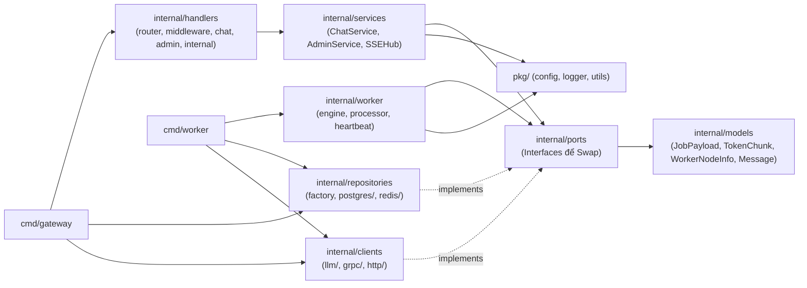

# Cấu Trúc Mã Nguồn Dự Án (`proj8_godistributed_llm`)

Cấu trúc thư mục kết hợp **Layered Architecture (`handlers / services / models / repositories / clients / utils`)** và **Ports (Interfaces)** giúp code dễ đọc, dễ scale ngang và swap tự do từng thành phần hạ tầng (Database, Message Queue, LLM Engine, Token Transport).

Tham chiếu: [docs/overview.md](file:///d:/A_Self_Proj/learn_mlflow/proj8_godistributed_llm/docs/overview.md) | [docs/tech-stack.md](file:///d:/A_Self_Proj/learn_mlflow/proj8_godistributed_llm/docs/tech-stack.md) | [docs/workflow.md](file:///d:/A_Self_Proj/learn_mlflow/proj8_godistributed_llm/docs/workflow.md)

---

## 1. Sơ Đồ Phụ Thuộc Giữa Các Tầng



---

## 2. Cây Thư Mục Chi Tiết

```text
proj8_godistributed_llm/
├── README.md                            # Tài liệu hướng dẫn chính & Quick Start
├── .gitignore                           # Ignore bin/, *.exe, .next/, node_modules/, .env
├── go.work                              # Go Workspace trỏ tới ./backend cho IDE
│
├── docs/                                # Toàn bộ tài liệu kiến trúc & luồng vận hành
│   ├── overview.md
│   ├── tech-stack.md
│   ├── structure.md
│   └── workflow.md
│
├── backend/
│   ├── api/
│   │   └── proto/
│   │       ├── llm_stream.proto         # Hợp đồng gRPC Protobuf
│   │       ├── llm_stream.pb.go
│   │       └── llm_stream_grpc.pb.go
│   │
│   ├── cmd/
│   │   ├── gateway/main.go              # Entrypoint API Gateway (Wire repos -> services -> handlers + gRPC)
│   │   └── worker/main.go               # Entrypoint Worker Node (Wire redis + llm client + streamer -> worker)
│   │
│   ├── configs/
│   │   ├── gateway.yaml                 # Cấu hình HTTP (:8088), gRPC (:50051), Redis, Postgres driver, Auth API key
│   │   ├── worker.yaml                  # Cấu hình Worker 1 (transport grpc/http, models, semaphore, ollama)
│   │   └── worker.node2.example.yaml    # Cấu hình mẫu cho Máy 2 chạy Worker trong LAN
│   │
│   ├── internal/
│   │   ├── models/                      # [MODELS] Struct thực thể thuần túy
│   │   │   ├── job.go                   # JobPayload, TokenChunk, JobStatus
│   │   │   ├── node.go                  # WorkerNodeInfo
│   │   │   └── chat.go                  # User, Conversation, Message, UsageLog
│   │   │
│   │   ├── ports/                       # [INTERFACES] Chốt chặn Swap hạ tầng (DB, Queue, LLM, Streamer)
│   │   │   ├── llm_provider.go          # LLMProvider
│   │   │   ├── job_queue.go             # JobQueue
│   │   │   ├── event_bus.go             # EventBus, NodeRegistry
│   │   │   ├── token_streamer.go        # TokenStreamer
│   │   │   └── repository.go            # Repository
│   │   │
│   │   ├── services/                    # [SERVICES] Business Logic & Real-time Hub
│   │   │   ├── sse_hub.go               # SSEHub + sse_hub_test.go
│   │   │   ├── sse_hub_test.go
│   │   │   ├── chat_service.go          # EnqueueChat, CancelJob, SaveAssistantResult, GetHistory
│   │   │   └── admin_service.go         # ListOnlineNodes, GetQueueStats, SetNodeDraining
│   │   │
│   │   ├── handlers/                    # [HANDLERS] HTTP Gin mỏng (Bind request -> Call service -> Write response)
│   │   │   ├── router.go                # Đăng ký route /api/v1/*, /internal/v1/*, /healthz
│   │   │   ├── middleware.go            # CORS + Optional API Key Auth (X-API-Key / Bearer)
│   │   │   ├── chat_handler.go          # POST /chat, POST /chat/stream, POST /chat/:id/stop, GET /history
│   │   │   ├── admin_handler.go         # GET /admin/nodes, GET /admin/queues, POST /drain, POST /resume
│   │   │   ├── internal_handler.go      # POST /internal/v1/tokens/stream & /push
│   │   │   └── api_routes_test.go       # Integration test cho toàn bộ HTTP API & Auth
│   │   │
│   │   ├── repositories/                # [REPOSITORIES] Lưu trữ & Hàng đợi (Swap qua Factory)
│   │   │   ├── factory.go               # NewRepository(driver, dsn) -> postgres | noop
│   │   │   ├── postgres/
│   │   │   │   ├── db.go                # pgxpool + chạy migrations.InitSQL
│   │   │   │   └── chat_repo.go         # ChatRepository + NoopRepository
│   │   │   └── redis/
│   │   │       ├── client.go            # Redis pool + Ping
│   │   │       ├── stream_queue.go      # Redis Streams (XADD, XREADGROUP, XACK, XAUTOCLAIM)
│   │   │       ├── pubsub_bus.go        # Redis Pub/Sub (STOP signals)
│   │   │       └── node_registry.go     # Heartbeat TTL 12s, SCAN, Drain flags
│   │   │
│   │   ├── clients/                     # [CLIENTS] Kết nối Local LLM & Token Transport
│   │   │   ├── llm/
│   │   │   │   ├── factory.go           # NewLLMProvider(provider, baseURL) -> ollama | llamacpp
│   │   │   │   ├── ollama_adapter.go
│   │   │   │   ├── ollama_adapter_test.go
│   │   │   │   └── llamacpp_adapter.go
│   │   │   ├── grpc/
│   │   │   │   ├── grpc_server.go       # Nhận gRPC stream đẩy vào services.SSEHub
│   │   │   │   └── grpc_client_pool.go  # Worker pool kết nối gRPC tới các Gateway
│   │   │   └── http/
│   │   │       ├── token_client.go      # Worker stream HTTP NDJSON tới Gateway
│   │   │       └── token_client_test.go
│   │   │
│   │   └── worker/                      # [WORKER] Điều phối máy trạm Local LLM
│   │       ├── engine.go                # Semaphore, Drain check, XREADGROUP, XAUTOCLAIM
│   │       ├── processor.go             # Job execution + Cancel listener + Stream + XACK
│   │       ├── processor_test.go
│   │       └── heartbeat.go             # Ticker 5s báo cáo CPU/RAM & ONLINE/DRAINING
│   │
│   ├── migrations/
│   │   ├── 001_init.sql                 # SQL DDL cho chat_messages & usage_logs
│   │   └── embed.go                     # //go:embed 001_init.sql
│   │
│   ├── pkg/
│   │   ├── config/loader.go             # Đọc YAML + ENV overrides
│   │   ├── logger/logger.go             # Structured Logging (log/slog)
│   │   └── utils/sysinfo.go             # Đo % CPU & RAM qua gopsutil/v4
│   │
│   ├── scripts/
│   │   ├── test_api.http                # 9 HTTP request mẫu dùng trực tiếp trong IDE
│   │   └── test_api.ps1                 # Script PowerShell test tự động
│   │
│   ├── deployments/
│   │   ├── Dockerfile.gateway
│   │   ├── Dockerfile.worker
│   │   └── docker-compose.yml           # Mặc định Redis + Postgres; --profile cluster chạy 2 LLM + 2 Worker
│   │
│   ├── Makefile
│   ├── go.mod
│   └── go.sum
│
└── frontend/                            # [FRONTEND] Next.js 15 + TypeScript + Tailwind + Lucide React
    ├── src/
    │   ├── app/
    │   ├── components/
    │   │   ├── ChatWorkspace.tsx        # Chat SSE, Stop, Load History, Model Selector
    │   │   └── AdminDashboard.tsx       # Worker Telemetry, Drain/Resume control, Queue Backlog
    │   ├── lib/gateway-client.ts
    │   └── types/api.ts
    ├── .env.local
    └── package.json
```
