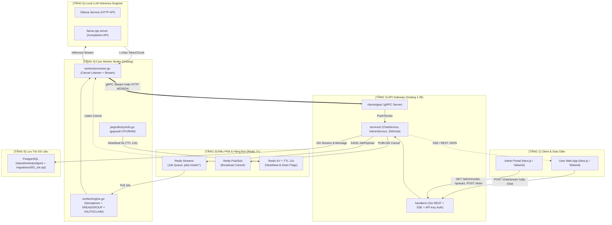

# Kiến Trúc Tech Stack Hệ Thống Phân Tán LLM

Tài liệu chi tiết công nghệ, thư viện, giao thức truyền thông và cơ chế tách tầng cho hệ thống **Go Distributed LLM** theo chuẩn **Production Layered + Ports/Factory** (dễ đọc, dễ scale ngang và swap tự do Database, Queue, LLM Engine, Token Transport).

Tham chiếu: [docs/structure.md](file:///d:/A_Self_Proj/learn_mlflow/proj8_godistributed_llm/docs/structure.md) | [docs/overview.md](file:///d:/A_Self_Proj/learn_mlflow/proj8_godistributed_llm/docs/overview.md)

---

## 1. Sơ Đồ Kiến Trúc Luồng Dữ Liệu & Công Nghệ

---

## 2. Bảng Tổng Hợp Tech Stack & Điểm Swap

| Tầng (Layer) | Công nghệ / Thư viện | Vai trò trong hệ thống | Điểm Swap & File phụ trách |
| :--- | :--- | :--- | :--- |
| **Handlers** | **Gin** (`internal/handlers`) | Tiếp nhận HTTP REST, SSE, Internal Token Stream; xác thực API Key (`X-API-Key` / `Bearer`). | [router.go](file:///d:/A_Self_Proj/learn_mlflow/proj8_godistributed_llm/backend/internal/handlers/router.go), [middleware.go](file:///d:/A_Self_Proj/learn_mlflow/proj8_godistributed_llm/backend/internal/handlers/middleware.go) |
| **Services** | **Pure Go** (`internal/services`) | Điều phối nghiệp vụ Chat (`EnqueueChat`, `CancelJob`, `SaveAssistantResult`), Admin (`DrainNode`) và `SSEHub`. | [chat_service.go](file:///d:/A_Self_Proj/learn_mlflow/proj8_godistributed_llm/backend/internal/services/chat_service.go), [admin_service.go](file:///d:/A_Self_Proj/learn_mlflow/proj8_godistributed_llm/backend/internal/services/admin_service.go), [sse_hub.go](file:///d:/A_Self_Proj/learn_mlflow/proj8_godistributed_llm/backend/internal/services/sse_hub.go) |
| **Models & Ports** | **Pure Go** (`internal/models`, `internal/ports`) | Định nghĩa struct thực thể và interface chuẩn cho toàn bộ DB, Queue, LLM, Streamer. | [internal/ports](file:///d:/A_Self_Proj/learn_mlflow/proj8_godistributed_llm/backend/internal/ports), [internal/models](file:///d:/A_Self_Proj/learn_mlflow/proj8_godistributed_llm/backend/internal/models) |
| **Repositories (DB)** | **PostgreSQL** (`jackc/pgx/v5`) | Lưu tin nhắn, usage log; quản lý schema qua `migrations/001_init.sql`. | Swap driver (`postgres` / `noop` / mở rộng `mysql`, `sqlite`) tại [repositories/factory.go](file:///d:/A_Self_Proj/learn_mlflow/proj8_godistributed_llm/backend/internal/repositories/factory.go) |
| **Repositories (Queue)** | **Redis 7+** (`redis/go-redis/v9`) | Redis Streams (hàng đợi), Pub/Sub (cancel), KV TTL 12s (heartbeat & drain flag). | Swap qua `ports.JobQueue`, `ports.EventBus`, `ports.NodeRegistry` tại [repositories/redis](file:///d:/A_Self_Proj/learn_mlflow/proj8_godistributed_llm/backend/internal/repositories/redis) |
| **Clients (LLM)** | **Ollama** / **llama.cpp server** | Gọi inference stream local trên CPU/GPU của từng Worker. | Swap qua `LLM_PROVIDER=ollama` hoặc `llamacpp` tại [clients/llm/factory.go](file:///d:/A_Self_Proj/learn_mlflow/proj8_godistributed_llm/backend/internal/clients/llm/factory.go) |
| **Clients (Transport)** | **gRPC + Protobuf** / **HTTP NDJSON** | Stream token từ Worker về đúng Gateway. | Swap qua `WORKER_TRANSPORT=grpc` hoặc `http` ([clients/grpc](file:///d:/A_Self_Proj/learn_mlflow/proj8_godistributed_llm/backend/internal/clients/grpc), [clients/http](file:///d:/A_Self_Proj/learn_mlflow/proj8_godistributed_llm/backend/internal/clients/http)) |
| **Frontend** | **Next.js 15 + Tailwind + Lucide** | User Chat SSE + Stop + Load History; Admin Telemetry + Drain/Resume Node. | [frontend](file:///d:/A_Self_Proj/learn_mlflow/proj8_godistributed_llm/frontend) |
